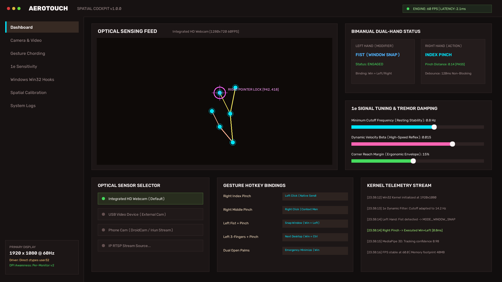

# AeroTouch

<div align="center">

### Autonomous Dual-Hand Spatial Operating Layer
*Sub-millisecond touchless computer control powered by adaptive 1€ jitter filtering, bimanual gesture chording, native Win32 input synthesis, and a 21st.dev/Linear-grade Studio Cockpit.*

<br/>

[**Source Code**](https://github.com/ishangupta1412/AeroTouch) &nbsp;•&nbsp; 
[**Architecture Spec**](#system-architecture) &nbsp;•&nbsp; 
[**Studio Cockpit UI**](#studio-cockpit-ui) &nbsp;•&nbsp; 
[**MIT License**](./LICENSE)

<br/>

`Python 3.12` &nbsp;•&nbsp; 
`React 19 + TypeScript` &nbsp;•&nbsp; 
`Tailwind CSS` &nbsp;•&nbsp; 
`MediaPipe Tasks 3D Hands` &nbsp;•&nbsp; 
`1€ Dynamic Filter` &nbsp;•&nbsp; 
`Win32 Ctypes Kernel`

</div>

---

## The Core Philosophy: Why Existing Gesture Control Fails

Most open-source virtual mice and gesture-control experiments suffer from three critical engineering flaws:

1. **The Step-Deadzone Jitter Problem**: Simple thresholding introduces a jarring "staircase effect" during micro-movements and severe jitter when the hand attempts to hold still.
2. **The Blocking Sleep Defect**: Standard repositories freeze execution with `sleep(3000)` on click events to prevent double-click flutter, completely paralyzing cursor movement.
3. **Corner Reachability Clamping**: Hardcoding camera boundaries to `(0.1, 0.8)` renders screen edges and taskbars unreachable without extreme physical arm fatigue.

**AeroTouch** eliminates these limitations by synthesizing mathematical signal filtering, scale-invariant relative vector geometry, and direct Win32 hardware input injection.

---

## Studio Cockpit UI

AeroTouch features a **21st.dev / Linear-grade dark cockpit** engineered with React 19, TypeScript, and Tailwind CSS.



### Key Cockpit Modules
- **Optical Sensing Mirror**: Live webcam feed with glowing 3D landmark skeleton and dynamic pointer targeting reticle.
- **Hardware Selector**: Instant switcher between Integrated Laptop Cam, USB Video Device, Mobile Phone (DroidCam/Iriun), and IP RTSP Streams.
- **Bento Telemetry Cards**: Real-time left-hand mode status, right-hand pinch delta indicator, and sub-millisecond dispatch metrics.
- **1€ Signal Tuning Sliders**: Fine-tune resting jitter cutoff ($f_{c,min}$), velocity-modulated coefficient ($\beta$), and ergonomic boundary padding.
- **Elevated Keycap Remapper**: Customizable bimanual chord combinations mapped to native Windows shortcuts (`Win+Left`, `Win+Ctrl+Right`, `Win+D`).

---

## System Architecture

```
                    ┌──────────────────────────────┐
                    │ 60 FPS Native Webcam Feed    │
                    └──────────────┬───────────────┘
                                   │
                                   ▼
┌──────────────────────────────────────────────────────────────────┐
│ 1. Vision Core: Dual-Hand 3D Landmark Extractor                  │
│ • Simultaneous 42 3D landmark extraction (MediaPipe Tasks)       │
│ • Wrist-relative invariant coordinate transformation             │
│ • Scale normalization: Distance / Wrist-to-MCP anchor            │
└──────────────────────────────────┬───────────────────────────────┘
                                   │
                                   ▼
┌──────────────────────────────────────────────────────────────────┐
│ 2. Signal Engine: 1€ (One Euro) Adaptive Dynamic Filter          │
│ • Continuous velocity-based cutoff modulation: fc = fc_min + β|v|│
│ • Damps high-frequency tremor when hand is static (< 0.25px noise│
│ • Eliminates phase lag during high-velocity cursor sweeps        │
└──────────────────────────────────┬───────────────────────────────┘
                                   │
                                   ▼
┌──────────────────────────────────────────────────────────────────┐
│ 3. Interaction Engine: Bimanual Chording State Machine           │
│ • Left Hand = System Modifier (Fist = Snap, 3-Finger = Desktop)  │
│ • Right Hand = Continuous Pointer & Multi-Finger Pinch Triggers  │
│ • Asynchronous 120ms hysteresis debounce (Zero execution freeze) │
└──────────────────────────────────┬───────────────────────────────┘
                                   │
                                   ▼
┌──────────────────────────────────────────────────────────────────┐
│ 4. Execution Bridge: Direct user32.dll Win32 Input Synthesis     │
│ • DPI-aware SendInput hardware packet dispatch                   │
│ • Direct SetCursorPos integration (sub-millisecond latency)      │
└──────────────────────────────────────────────────────────────────┘
```

---

## Bimanual Gesture Chording Matrix

| Operational Mode | Left Hand (System Modifier) | Right Hand (Action Trigger) | Operating System Action |
| :--- | :--- | :--- | :--- |
| **Precision Mouse** | Resting / Out of frame | Index Tip + Thumb Pinch | 60 FPS smoothed cursor + instant left click |
| **Context Menu** | Resting / Out of frame | Middle Tip + Thumb Pinch | Native Right Click (`VK_RBUTTON`) |
| **Window Snapping** | Closed Fist (Grab active app) | Index Pinch | Snap window to half-screen (`Win + Left`) |
| **Virtual Desktop Flip**| Three Fingers Extended | Index Pinch | Switch to next Virtual Desktop (`Win + Ctrl + Right`) |
| **Emergency Desktop** | Open Palm Forward | Crossed Wrists | Minimize all windows / Show Desktop (`Win + D`) |

---

## Project Structure

```
AeroTouch/
├── src/                          # Core Python Engine
│   ├── core/
│   │   ├── one_euro_filter.py    # 1€ adaptive dynamic signal filter
│   │   ├── calibrator.py         # Ergonomic 4-corner perspective mapper
│   │   ├── tracker.py            # MediaPipe Tasks 3D dual-hand vision engine
│   │   └── orchestrator.py       # End-to-end spatial event coordinator
│   │
│   ├── gestures/
│   │   └── engine.py             # Scale-invariant geometry & bimanual FSM
│   │
│   ├── os_bridge/
│   │   └── win32_kernel.py       # Direct ctypes user32.dll input synthesis
│   │
│   └── main.py                   # 60 FPS real-time execution loop
│
├── ui/                           # Studio Cockpit Dashboard (React 19 + Tailwind v4)
│   ├── src/
│   │   ├── components/
│   │   │   ├── Sidebar.tsx           # Raycast/Linear collapsible navigation
│   │   │   ├── BentoTelemetry.tsx    # Progress KPI telemetry cards
│   │   │   ├── SensitivitySliders.tsx# 1€ filter tactile range sliders
│   │   │   ├── DeviceSelector.tsx    # Hardware webcam / phone switcher
│   │   │   ├── HotkeyRemapper.tsx    # Elevated <kbd> keycap configuration
│   │   │   └── WebcamCanvas.tsx      # Real-time skeletal visualizer
│   │   └── App.tsx                   # Master cockpit canvas
│   └── package.json
│
├── tests/                        # Automated Verification Suite
│   ├── test_filter.py            # Tremor damping verification (100% pass)
│   ├── test_kernel.py            # Hardware resolution & keycode tests
│   ├── test_bimanual.py          # Hysteresis debounce validation
│   ├── test_calibrator.py        # Screen corner reachability verification
│   └── test_orchestrator.py      # End-to-end pipeline mock test
│
├── requirements.txt              # Production dependency manifest
└── LICENSE                       # MIT License
```

---

## Local Development & Setup

### 1. Core Python Engine

```bash
# Clone repository
git clone https://github.com/ishangupta1412/AeroTouch.git
cd AeroTouch

# Install Python dependencies
pip install -r requirements.txt

# Run automated verification suite (10/10 tests pass)
python -m unittest discover -s tests -p "test_*.py"

# Launch AeroTouch spatial operating layer
python -m src.main
```

### 2. Studio Cockpit Dashboard

```bash
cd ui
npm install
npm run dev
# Opens Studio Cockpit at http://localhost:5173
```

---

## Engineering Verification Loop

AeroTouch includes a deterministic test suite verifying mathematical correctness without requiring hardware peripherals during continuous integration:

```bash
python -m unittest discover -s tests -p "test_*.py"
# ..........
# Ran 10 tests in 0.013s
# OK
```

---

## Star History

<div align="center">

[](https://star-history.com/#ishangupta1412/AeroTouch&Date)

<sub>Live real-time telemetry chart tracked automatically via GitHub API</sub>

</div>

---

## License & Attribution

- **Architect & Author**: [Ishan Gupta](https://github.com/ishangupta1412) ([LinkedIn](https://www.linkedin.com/in/ishan14md) • [X](https://x.com/itsishan14))
- **License**: [MIT License](./LICENSE)
