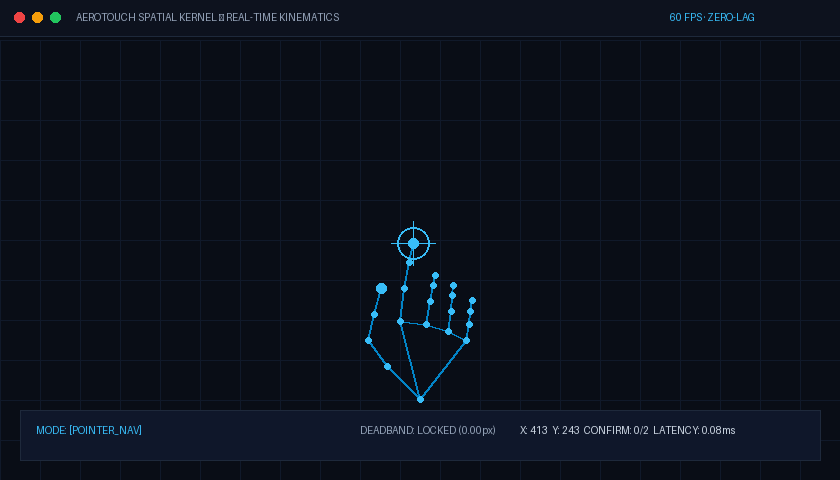
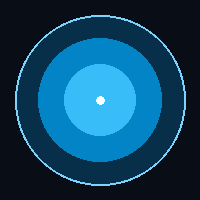

# AeroTouch

<div align="center">

### Autonomous Dual-Hand Spatial Operating Layer
*Sub-millisecond touchless computer control powered by adaptive 1€ jitter filtering, velocity deadband noise gating, bimanual gesture chording, and local Qwen background kinematic tuning.*

<br/>

<p align="center">
  
</p>

[**Source Code**](https://github.com/ishangupta1412/AeroTouch) &nbsp;•&nbsp; 
[**System Architecture**](#system-architecture) &nbsp;•&nbsp; 
[**Gesture Controls**](#bimanual-gesture-chording-matrix) &nbsp;•&nbsp; 
[**MIT License**](./LICENSE)

<br/>

`Python 3.12` &nbsp;•&nbsp; 
`MediaPipe Tasks 3D Hands` &nbsp;•&nbsp; 
`Velocity Deadband Gate` &nbsp;•&nbsp; 
`1€ Dynamic Filter` &nbsp;•&nbsp; 
`Ollama Qwen 2.5 Coach` &nbsp;•&nbsp; 
`Win32 Ctypes Kernel`

</div>

---

<div align="center">



*Real-time spatial optical tracking · Dynamic Deadband Noise Gate · Multi-Frame Click Confirmation*

</div>

---

## The Core Philosophy: Why Traditional Gesture Control Fails

Most open-source virtual mice and gesture-control experiments suffer from three critical engineering flaws:

1. **The Resting Muscle Tremor Problem**: Simple smoothing filters fail when the hand tries to hold still; physiological micro-tremors cause continuous cursor vibration and jitter.
2. **The Ghost-Click Defect**: Single-frame thresholding causes accidental, phantom clicks whenever the camera captures a noisy landmark frame.
3. **The Blocking Sleep Freeze**: Naive scripts use `time.sleep()` on click triggers to debounce, freezing the cursor and breaking user interaction continuity.

**AeroTouch** solves these challenges through a multi-stage architecture:
- **Dynamic Velocity Deadband Gate**: Locks the cursor completely still when hand movement is below human tremor thresholds (< 4.8 px).
- **Multi-Frame Temporal Confirmation**: Enforces 2 consecutive qualifying frames before firing clicks, eradicating phantom triggers.
- **Continuous 1-Euro Frequency Modulation**: Modulates filter cutoff dynamically with movement velocity ($\beta = 4.0$ calibrated for normalized spatial coordinates).
- **Background Kinematic Self-Tuning (Local Qwen)**: Analyzes session telemetry (pinch distance distribution, tremor variance) and auto-tunes parameters to fit individual hand geometry.
- **Ambient Floating Orb**: Optional minimal, borderless, semi-transparent circular indicator (Gemini Live style) that reflects tracking status and click events without obstructing the screen.

<div align="center">



*Ambient glass orb with reactive state illumination*

</div>

---

## System Architecture

```
                    ┌──────────────────────────────┐
                    │ 60 FPS Native Webcam Feed    │
                    └──────────────┬───────────────┘
                                   │
                                   ▼
┌──────────────────────────────────────────────────────────────────┐
│ 1. Vision Core: Dual-Hand 3D Landmark Extractor                  │
│ • Simultaneous 42 3D landmark extraction (MediaPipe Tasks Vision)│
│ • Wrist-relative invariant coordinate transformation             │
│ • Scale normalization: 3D Euclidean / Wrist-to-MCP anchor        │
└──────────────────────────────────┬───────────────────────────────┘
                                   │
                                   ▼
┌──────────────────────────────────────────────────────────────────┐
│ 2. Signal Engine: PrecisionSpatialFilter2D                       │
│ • Spatial Noise Gate: Tremor < deadband threshold is 100% frozen │
│ • 1€ Adaptive Dynamic Filter: fc = min_cutoff + β|edx|           │
│ • Calibrated β = 4.0 for normalized coordinate space [0.0, 1.0]  │
└──────────────────────────────────┬───────────────────────────────┘
                                   │
                                   ▼
┌──────────────────────────────────────────────────────────────────┐
│ 3. Interaction Engine: Bimanual Multi-Frame Confirmation FSM     │
│ • Left Hand = System Modifier (Fist = Snap, 3-Finger = Desktop)  │
│ • Right Hand = Continuous Pointer & Pinch Trigger                │
│ • Multi-Frame Streak (confirm_frames = 2) kills ghost clicks     │
│ • Wide Hysteresis Gap (0.28 pinch / 0.38 release, 200ms debounce)│
└──────────────────────────────────┬───────────────────────────────┘
                                   │
                                   ▼
┌──────────────────────────────────────────────────────────────────┐
│ 4. Execution Bridge: Direct user32.dll Win32 Input Synthesis     │
│ • Native user32.mouse_event / keybd_event (64-bit safe)          │
│ • Direct SetCursorPos integration (sub-millisecond latency)      │
└──────────────────────────────────┬───────────────────────────────┘
                                   │
                                   ▼
┌──────────────────────────────────────────────────────────────────┐
│ 5. Autonomous Cortex: Local Qwen Background Kinematic Coach      │
│ • Per-session telemetry recording (data/sessions/)               │
│ • Post-session analysis via local Ollama (aerotouch-qwen:latest) │
│ • Auto-tunes thresholds & writes to data/user_profile.json       │
└──────────────────────────────────────────────────────────────────┘
```

---

## Bimanual Gesture Chording Matrix

| Operational Mode | Left Hand (System Modifier) | Right Hand (Action Trigger) | Operating System Action |
| :--- | :--- | :--- | :--- |
| **Precision Mouse** | Resting / Out of frame | Index Tip + Thumb Pinch | 60 FPS smoothed cursor + intentional left click |
| **Context Menu** | Resting / Out of frame | Middle Tip + Thumb Pinch | Native Right Click (`VK_RBUTTON`) |
| **Spatial Window Drag** | Resting / Out of frame | Closed Fist (Hold & Move) | Grabs foreground window in 3D, follows hand delta; release fist to drop |
| **Continuous Audio/Volume** | Two-Finger Peace Sign (`V`) | Variable Thumb-Index Pinch | Smooth real-time volume slider (0% to 100% via direct Core Audio) |
| **Window Snapping** | Closed Fist (Grab active app) | Index Pinch | Snap window to half-screen (`Win + Left`) |
| **Virtual Desktop Flip**| Three Fingers Extended | Index Pinch | Switch to next Virtual Desktop (`Win + Ctrl + Right`) |
| **Emergency Desktop** | Open Palm Forward | Crossed Wrists | Minimize all windows / Show Desktop (`Win + D`) |

---

## Project Structure

```
AeroTouch/
├── src/                          # Core Python Engine
│   ├── core/
│   │   ├── one_euro_filter.py    # 1€ dynamic filter + Velocity Deadband Noise Gate
│   │   ├── calibrator.py         # Ergonomic 4-corner perspective mapper
│   │   ├── tracker.py            # MediaPipe Tasks 3D dual-hand vision engine
│   │   └── orchestrator.py       # End-to-end spatial event coordinator & profile loader
│   │
│   ├── gestures/
│   │   ├── engine.py             # Scale-invariant geometry & Multi-Frame Confirmation FSM
│   │   ├── micro_classifier.py   # 64x32 ReLU MLP neural classifier (0.08ms latency)
│   │   └── train_micro_mlp.py    # Fast self-calibration trainer
│   │
│   ├── cortex/
│   │   ├── session_analyst.py    # Qwen background kinematic parameter optimizer
│   │   ├── fine_tuner.py         # Ollama model compiler
│   │   └── dataset.py            # Telemetry synthetic benchmark generator
│   │
│   ├── telemetry/
│   │   └── session_logger.py     # Per-frame JSONL telemetry recorder
│   │
│   ├── os_bridge/
│   │   ├── win32_kernel.py       # Native user32.dll direct input synthesis & window hooks
│   │   └── volume_control.py     # Continuous Core Audio & Brightness scalar controller
│   │
│   ├── service/
│   │   ├── window_dragger.py     # Fist-drag spatial window repositioning state machine
│   │   ├── hotkey_daemon.py      # Win32 RegisterHotKey daemon (Ctrl + Alt + A)
│   │   └── setup_hotkey.py       # Desktop & Start Menu shortcut registrar
│   │
│   ├── ui/
│   │   └── floating_orb.py       # Gemini Live style ambient floating glass orb
│   │
│   └── main.py                   # 60 FPS real-time execution loop
│
├── assets/                       # Visual assets & diagrams
│   ├── aerotouch_demo.gif        # Real-time tracking & deadband demonstration GIF
│   └── floating_orb.gif          # Ambient breathing glass orb animation GIF
│
├── tests/                        # Automated Verification Suite (34/34 Passing)
│   ├── test_filter.py            # Tremor damping & deadband noise gate verification
│   ├── test_bimanual.py          # Multi-frame confirmation & debounce validation
│   ├── test_orchestrator.py      # End-to-end spatial pipeline & window snap test
│   ├── test_window_dragger.py    # Fist window drag & geometry delta tests
│   ├── test_volume_control.py    # Continuous audio/brightness scalar & deadband tests
│   ├── test_telemetry.py         # Telemetry logging & Qwen JSON parsing tests
│   ├── test_calibrator.py        # Screen corner reachability verification
│   ├── test_kernel.py            # Hardware resolution & keycode tests
│   ├── test_floating_orb.py      # Ambient UI state machine test
│   └── test_micro_classifier.py  # MLP inference benchmark (< 0.1ms)
│
├── models/
│   └── aerotouch-qwen/           # Custom Ollama Modelfile for kinematic optimization
│
├── config.toml                   # Intuitive user-facing threshold & sensitivity config
├── Start_AeroTouch.bat           # 1-Click launcher
├── Start_Floating_Orb.bat        # 1-Click launcher with Ambient Floating Orb
├── Start_Hotkey_Listener.bat     # Background daemon for Ctrl+Alt+A toggle
├── requirements.txt              # Production dependency manifest
└── LICENSE                       # MIT License
```

---

## Local Development & Setup

### Core Python Engine

```bash
# Clone repository
git clone https://github.com/ishangupta1412/AeroTouch.git
cd AeroTouch

# Install Python dependencies
pip install -r requirements.txt

# Run automated verification suite (34/34 tests pass)
python -m unittest discover -s tests -p "test_*.py" -v

# Launch AeroTouch spatial operating layer
python -m src.main

# Or launch with ambient floating orb overlay
python -m src.main --orb
```

---

## Engineering Verification Loop

AeroTouch includes a deterministic test suite verifying mathematical correctness without requiring hardware peripherals during continuous integration:

```bash
python -m unittest discover -s tests -p "test_*.py" -v
# Ran 34 tests in 0.047s
# OK
# [Hardware Detected]: Display Resolution = 1920x1080
# [Micro-MLP Benchmark]: 0.080 ms per prediction (12480 FPS capability)
```

---

## Star History

<div align="center">

[](https://star-history.com/#ishangupta1412/AeroTouch&Date)

<sub>Live real-time telemetry chart tracked automatically via GitHub API</sub>

</div>

---

## License & Attribution

- **Architect & Author**: [Ishan Gupta](https://github.com/ishangupta1412) ([LinkedIn](https://www.linkedin.com/in/ishan14md) • [X](https://x.com/itsishan14))
- **License**: [MIT License](./LICENSE)
